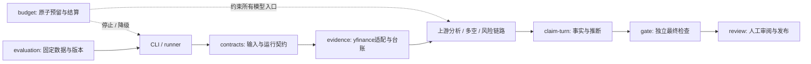

# EvidenceGuard TradingAgents 架构蓝图 v0.2

状态：用户已授权增量实施；具体代码审阅待完成。本文件是设计，执行证据另见docs/progress.md。

## 边界与权威

产品为本地Python CLI，用于单股票研究。首版AAPL/MSFT/NVDA，market/news分析师，研究与风险辩论各一轮。行情和新闻沿用yfinance读取，不接券商或真实交易。

LLM只提出观点、事实/推断卡片及冲突；确定性程序拥有配置、证据资格、预算、验证和发布状态的权威。人工批准具体产物，不能替代门禁。

## 模块和集成

新增模块集中在`src/evidenceguard/`：contracts、evidence、claims、budget、gate、review、runner、evaluation。保留上游`tradingagents/`、`cli/`、`tests/`，新增课程测试放入`test/offline/`和`test/live/`；不复制或整体移动上游。

三个集成位置：选定行情/新闻工具登记证据；LLM工厂包裹所有sync/async、tool和structured/plain路径；最终输出统一进入gate。经理和最终观点必须保留论点引用。

LLM返回`DebateTurn(cards, reply_to, conflicts, stop_reason)`；程序分配ID并确定性渲染回上游history/current_response。五个辩论角色共享适配器，不做额外逐角色抽取调用。

## 资源与状态

默认每run 60,000 tokens、30次模型尝试、900秒；每调用输入上限8,000、输出1,024；瞬时错误和格式修复各最多一次。SDK隐式重试关闭，所有再次请求必须重新预留。启动时串行调用，但预算存储仍须通过并发测试。

开发与应用共享95美元总账。本机relay在每个HTTP请求前预留美元，覆盖OpenCode标题、压缩及其他辅助调用；OpenCode事件仅作核对。发布元数据、最坏输入/输出和usage语义需通过预检；无法保守界定时停止，不以usage缺失为零。

执行、验证、审阅、发布为四个独立状态轴。只有completed + passed + 当前hash人工approved可released。任何证据、业务配置、论点、报告或策略变更都产生新修订并使旧批准失效。

## 设计与验证索引

- [ADR与接口](docs/architecture/adr/ADR-001-incremental-boundaries.md)、[interface-contracts](docs/architecture/interface-contracts.md)
- [候选比较](docs/architecture/candidate-evaluation.md)、[不变量](docs/architecture/invariants.md)、[追踪矩阵](docs/architecture/trace-matrix.md)
- [状态与保留](docs/architecture/memory-state.md)、[权限](docs/architecture/permission-model.md)、[运行处置](docs/architecture/runtime-policies.md)
- [验证计划](docs/verification/test-plan.md)、[执行计划](docs/execution-plan.md)

门禁无法证明来源事实一定正确。语义支持和实用性由预登记的单人标注/复核协议测量；小样本不外推收益或统计显著提升。
