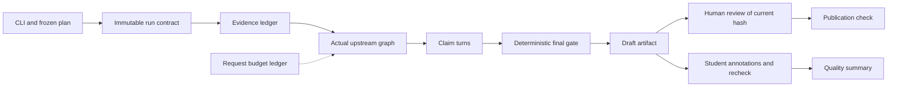

# EvidenceGuard TradingAgents

**Engineering report draft — current implementation, pending genuine experiments and student reflection.**

This document is prepared with Codex assistance. Application source, tests and application prompts are generated or repaired through local OpenCode using the CityU course model `CS5351/DeepSeek-V4-Flash`. The sole student remains the only human author of personal reflection and the only human approver. This draft is not a completed submission: the paired business evaluation, delayed human recheck, final pagination, video and submission package remain outstanding.

## 1. Problem and scope

A multi-agent stock research system can produce a persuasive conclusion whose references, timestamps and cost are difficult to inspect. A successful model response does not establish that a cited source was available at the analysis cutoff, that a claim is supported by that source, or that a result has received human approval. Adding more model critique alone would leave those decisions inside the same probabilistic system.

EvidenceGuard extends the existing TradingAgents research flow with a deterministic evidence and release boundary. Its intended user is one student conducting a reproducible comparison of research reports. The initial scope is AAPL, MSFT and NVDA; market and news analysts; one investment debate round and one risk debate round. It provides a local CLI, draft artifacts, a repeatable evaluation protocol and a separately developed browser report viewer. It has no broker connection, order execution or payment function.

The project retains all seven functional requirements: versioned run contracts; evidence collection and qualification; claim and conflict cards; independent final validation; request-level resource accounting; reproducible replay and evaluation; and hash-bound human review and publication. Detailed fit criteria, source IDs and negative scenarios are in `docs/req/requirements.yaml`. Their existence records the specification, not successful business acceptance.

The research questions are whether the added boundaries reject the specified invalid states, whether the actual provider and upstream graph work together under bounded resources, and whether the candidate produces at least as many usable reports as baseline while reducing total tokens. The last two questions require actual provider experiments. Offline tests cannot answer them.

## 2. Baseline and reuse

The upstream reference is TauricResearch/TradingAgents at `9fa1196fffbcfd9de5146d2dd2869df84ab99838`. The local baseline import is `4419f12`. The upstream directory layout, license, assets and tests are retained. The extension resides in `src/evidenceguard/`; its offline tests reside in `test/offline/`.

The baseline already contains substantive model, financial data and graph behavior. EvidenceGuard does not claim to have invented those capabilities. Its compiled graph integration adds an optional boundary to `tradingagents/graph/setup.py`; the original default routing remains available. The candidate runs the actual upstream analysts, investment debate, trader, risk debate and final decision path. The baseline arm also uses the original graph, with the same external request accounting and frozen inputs needed for measurement.

A candidate/baseline comparison therefore measures the proposed combination of structured claim turns, bounded context and deterministic gates. It does not isolate a single prompting change. In particular, the candidate's context compaction discards ordinary upstream prompt detail while preserving tool-call protocol fields. ADR-003 records that deliberate change as an evaluation confound whose effect is still unmeasured.

## 3. Architecture and authority

The model proposes facts, inferences and conflicts. Deterministic code controls input validity, evidence eligibility, request reservation, status and release. The student supplies genuine review decisions and semantic labels. Source text and model output remain data; neither can change permissions, endpoints, spending limits or approval requirements.

A run manifest freezes the ticker, cutoff, analysts, model, prompt and policy versions, dataset hash, source versions and resource limits. Timestamps are timezone-aware and normalized to UTC. Invalid business configuration is rejected before market or model calls.

The evidence ledger preserves source URI, original content, content hash, retrieval time and the source's publication or availability time. Retrieval time does not establish historical availability. Unknown or future source times are retained as excluded evidence rather than silently replaced. Evidence IDs bind run identity and source content, and references cannot cross runs.

A shared claim-turn adapter serves the bull, bear and three risk roles. Fact cards require eligible evidence; inference cards require evidence or parent claims. Parent references must exist and be acyclic. Conflicts and replies refer to existing cards. A deterministic renderer inserts the validated structure into the existing graph history without an extra model extraction call for every role.

The final gate rechecks the actual artifact, manifest, evidence and claim references. It rejects unsupported schema/state shapes, missing evidence, invalid references and report citations to absent claims. This proves structural properties. It does not prove that an otherwise well-formed sentence is semantically entailed by the cited financial source.

## 4. Budget, failures and publication

The project spending ceiling is USD95, divided into USD55 for development and USD40 for application use. No top-up or personal-provider fallback is authorized. Local OpenCode generation passes through the recovered authentic request-level transport; the application uses its own run and project ledgers within the allocation. Amounts are accumulated using integer microdollars or decimal representations rather than floating-point cumulative arithmetic.

Every real HTTP request reserves a conservative input/output bound before transmission. Auxiliary generation, retries and format repair also consume a request and budget. The SDK does not perform hidden retries. Known usage settles the reservation; unknown usage retains it and stops further generation. A stopped request is not converted into zero cost.

Execution, validation, review and publication are separate state axes. An execution can fail while leaving a useful draft. A completed output can fail validation. A structurally valid output can remain unreviewed. Publication requires completed execution, an independently passing current gate and a real approval bound to the current artifact business hash.

The artifact hash covers an explicit canonical business projection, including manifest, evidence, claims and report. Measurements and review events are separate. Publishing reconstructs the current gate and hash so that editing a report after approval invalidates the authorization. Test fixture approvals are restricted to explicit test stores; they are not actual student approvals. No genuine publication has been performed by the agent.

## 5. Implementation workflow and observed defects

Codex prepares module-sized tasks with explicit paths and commands, captures the course model's complete source verbatim, reviews the result, runs checks and returns defects to OpenCode. It does not silently replace the required coding harness. Source provenance records the captured session and hash, while separately recording generated patches and mechanical formatting. A generated module is not assumed correct merely because it parses.

Observed defects include a missing return in source URI validation, which could merge distinct sources; incorrect conversion of validated cards during review; budget transaction and stop-state errors; model-message handling that bypassed debate parsing; and context compression that lost tool-call fields. An independent evaluation test also exposed measurement metadata incorrectly overriding the artifact's top-level failed state. Repairs were returned through OpenCode, and failed outputs were retained.

Later generated tests repeatedly invented package names and fixture fields. These were preparation defects, not reasons to change the application to match an invented interface. Smaller tasks and exact public-interface context reduced those mistakes. The quality summary also needed an integer comparison at the exact 20% saving boundary to avoid floating-point threshold ambiguity. The bug diary identifies these cases and their actual regression evidence.

A machine restart removed earlier transient `/tmp` source sessions and harness files. The exact harness was recovered from an authentic prior tool output and checked with a zero-cost mock. Six previously exported native sessions, source hashes and the cumulative budget ledger survived. Subsequent sessions are immediately archived in persistent private storage. The missing originals are disclosed; summaries are not presented as recovered raw transcripts.

The user explicitly delegated creation of `.opencode/rules.md` to Codex. Its actual authorship is recorded. That instruction does not make the file independently student-authored or establish compliance with a course Human-only authorship condition. It also supplies no approval of later code or experiments.

## 6. Verification evidence

The historical backend checkpoint records 1,617 passed tests and 100 passed subtests, with one optional AWS skip and one online integration test deselected. New quality, governance and batch execution tests extend that checkpoint. Current commands, counts and source hashes are recorded in `docs/verification/current-review.md` and its manifest; the historical checkpoint does not cover later edits.

Graph and transport tests exercise actual SDK serialization and compiled upstream graph nodes with synthetic data and MockTransport. Snapshot tests preserve source-time distinctions. Budget tests cover atomic reservations, idempotent settlements, retry limits and unknown usage. Review tests exercise changed hashes and invalid publication attempts. All remain offline engineering evidence.

The batch CLI's tests verify fixed paired order, failed-draft retention, version mismatch, tracked/untracked source changes, existing-output rejection, blank annotation templates and deterministic quality summaries. Governance fixtures test valid bindings and tampering in plan hashes, annotation hashes, versions, groups, budgets, content and candidate gate status. Those synthetic labels exist only in temporary test directories.

The course workflow defines six checks: test-approval, static-analysis, requirements-schema, semantic-evaluation, regression and ai-use-log. Missing genuine approval and formal semantic evidence must fail. A workflow file is not proof that a protected branch enforces it. Actual run URLs, observed failures and repository settings are recorded separately when available. No course API secret is installed in CI.

## 7. Preregistered business evaluation

The planned experiment freezes one common current snapshot per ticker, a committed candidate source version, the course model and a 12-row order. Each ticker has two repeats and both arms. AAPL uses B/C then C/B; MSFT C/B then B/C; NVDA B/C then C/B. Pilot output stays separate and cannot be relabelled as a formal repeat.

The serial executor keeps every failed, stopped and not_run row. Each produced artifact retains its actual status, business hash, usage and error information. Budget stops prevent remaining paid calls while preserving those rows in the denominator. Baseline does not fail semantic usefulness solely because it lacks the candidate claim schema.

The student identifies important factual statements and labels them supported, unsupported or unverifiable. The latter two count against support. Five binary rubric fields assess relevance, completeness, traceability, uncertainty and clarity. Initial labels, reasons and evidence references are retained; a second self-review occurs at least 24 hours later. This is not a second independent rater, and visible structural differences may reveal the arm.

A usable report must complete, contain at least one reviewed important fact, achieve support at least 0.95 and rubric at least 4/5. Candidate reports also need gate passed. At least five of six candidates must be usable, and their usable count must be no lower than baseline. The Should-level cost target is candidate tokens no greater than 80% of baseline, counting failed requests and all retries. Unknown usage makes the saving result unknown. A numerical saving alone does not meet the combined quality-and-cost requirement.

**Actual results: pending.** There are no approved pilot outcomes, twelve-run business results, student fact labels or delayed recheck to insert here. No quality improvement, token saving or investment return is claimed.

## 8. Limitations and remaining delivery

The dataset is small and descriptive. It cannot establish statistical significance, investment profitability or behavior across arbitrary companies and market regimes. Single-student annotations may be biased. Delayed rechecking improves traceability but does not create independent agreement evidence. Provider behavior may differ from SDK mocks, and a structurally valid citation may still be semantically wrong.

Current Yahoo responses expose source update times, not a complete historical point-in-time archive. Source latency and later revisions remain limitations. The bounded candidate context changes the information presented to roles, so a measured effect cannot automatically be attributed to deterministic gates alone. A browser viewer displays artifact states; it cannot replace a fresh gate or authorize release.

The public repository must contain only sanitized artifacts. Keys, financial account metadata, private course originals, raw private sessions, environments, caches and submission archives stay excluded. The final report must be rendered and checked against the course length and page requirements; this draft has not established those conditions. The final ten-minute MP4 is submitted separately from the ZIP.

## 9. Student contribution and reflection

There is one student, with the planned human contribution allocation of 100% and weight 1.0. This allocation does not imply that all source was manually written. AI assistance, authentic sessions, generated code, orchestrator documentation and human decisions remain distinguished in the AI-use log.

**Student-authored 300–500 word reflection: pending genuine student input.** It should describe specific decisions, mistakes, personal review and lessons from the actual evaluation. This draft does not supply invented first-person experience or a student signature.

## References and evidence index

- TauricResearch, TradingAgents, pinned upstream `9fa1196fffbcfd9de5146d2dd2869df84ab99838`; original Apache-2.0 license retained.
- `docs/req/requirements-analysis.md` and `docs/req/requirements.yaml`.
- `Blueprint.md`, `docs/architecture/interface-contracts.md`, ADR-001 through ADR-005.
- `docs/verification/test-plan.md`, `evaluation-cli-guide.md`, current review manifest and actual regression outputs.
- `docs/ai-sessions/index.md`, `docs/architecture/source-provenance.json`, `docs/ai-use-log.yaml`.
- `docs/bug-diary.md`, `docs/debt-register.md` and `docs/review-memo.md`.
