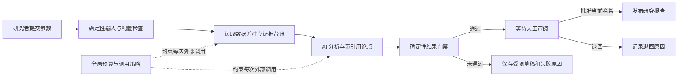

# TradingAgents 改进项目需求分析文档

| 项目 | 内容 |
| --- | --- |
| 暂定名称 | EvidenceGuard TradingAgents：证据可追踪、预算受控的 AI 股票研究系统 |
| 课程 / 小组 | CS5351 Software Engineering / Canvas Project Group 23 |
| 版本 / 日期 | v0.2 / 2026-11-19 |
| 状态 | **用户已授权增量实现；边界模块及离线回放已完成首轮验证，完整验收和具体人审待完成** |
| 已确认决策 | 单人、全部7项FR、课程API、最高95美元、公开仓库、三次常规人审 |
| 尚未确认 | 具体测试源码/安全代码人审、真实业务数据快照及完整集成验证 |
| 机器可读 PRD | [product.yaml](product.yaml) |
| 需求唯一编号与验收依据 | [requirements.yaml](requirements.yaml)，由 [req-schema.json](req-schema.json) 校验 |
| 基线研究 | [baseline-review.md](baseline-review.md) |

## 1. 目的与证据边界

本项目在 TradingAgents 的多智能体研究流程上，增加贯穿数据、推理、结果发布和评估的证据与预算控制，使读者能够回答：结论引用了什么、哪些检查真正执行了、失败后如何处置、一次研究用了多少资源。

课程要求可机器验证的需求、真实 AI 功能、确定性安全边界，以及人工监督的开发证据。本草案将这些要求转化为产品功能、质量目标、不变量和开发治理需求。业务研究系统内的 AI agent 与开发阶段的 OpenCode coding agent 是两种角色，权限和记录分开维护。

**所有数值阈值是本草案提出的工程目标，不是教师指定值，也不是已测得成绩。** 本次只完成需求分析与文档结构校验，没有运行上游应用、调用付费模型、收集真实业务样本或执行验收测试。

需求来源分为四类：课程明确要求、用户确认的方向、已阅读的上游代码事实、基于这些事实提出的设计假设。来源 ID 见机器可读注册表。基线是检查时获取的提交 `9fa1196fffbcfd9de5146d2dd2869df84ab99838`；它是候选基线，尚不能代表小组已有代码。

## 2. 问题定义与改进价值

### 2.1 已有能力与待解决问题

上游已经提供多角色研究、并行分析师、结构化输出、报告、token 统计、checkpoint 和日期边界保护。项目不将这些已有功能包装为原创。详细证据与固定版本链接见基线研究。

| 已有能力 | 本项目提出的增量 | 预期价值 |
| --- | --- | --- |
| 自然语言报告和部分结构化决策 | 为重要事实陈述建立 run 内的证据 ID、时间、原始片段和哈希链路 | 读者可核对引用，评估者可抽样核验语义支持 |
| 结构化调用失败时可退回自由文本 | 在最终发布边界执行独立 Schema、引用、时间与状态检查，未通过不得发布为有效报告 | 模型格式或引用错误不能依靠自然语言兜底越过边界 |
| 每次调用的输出上限、重试设置、CLI token 统计 | 对整次运行的所有模型调用、回退和重试统一预留及结算预算 | 控制累计消耗，失败后能解释费用与停止原因 |
| 多空及风险辩论 | 使用事实 / 推断分离的论点卡片与冲突记录，引用证据而非不断复制全部历史 | 检查推理输入，减少无效重复；效果由对照实验验证 |
| 已有报告导出和运行设置记录 | 导出新增的门禁判定、人工审阅状态、证据覆盖和前后对比指标 | 支持课程演示和可重放评估 |

这里不推断“上游不存在任何安全机制”或“已经证明改进有效”。例如，引用 ID 存在只能证明可追踪，不能证明该引用在语义上支持结论。

### 2.2 目标与成功判据

| 目标 | 相关需求 | 拟采用的成功证据 |
| --- | --- | --- |
| G1：结论可核对 | FR-002、FR-003、FR-004、QUAL-001 | 证据解析与时间检查全部通过；单人标注与间隔复核的重要事实支持率 ≥ 0.95 |
| G2：资源消耗可控制 | FR-005、INV-004、COST-001 | 模拟预算越界零次；对照实验总 token 比率 ≤ 0.80，且可用率满足保护条件 |
| G3：失败可解释且不可绕过 | FR-004、FR-007、INV-002 | 错误输出、失效审批、绕过发布的负面案例均被阻止 |
| G4：工程过程可审计 | GOV-001 至 GOV-007 | 需求、设计、代码、测试和真实人工批准记录对应；六类门禁有阻断证据 |

成本优化是 Should 目标；当它与事实完整性或安全检查冲突时，优先保留正确性并报告成本目标未达到。

## 3. 利益相关者与用户需求

| 角色 | 需求 | 可观察成果 |
| --- | --- | --- |
| 研究使用者 | 指定股票和分析日期，阅读有出处的研究结果 | 输入回执、报告状态、证据索引、资源摘要 |
| 人工审阅者 | 判断重要事实是否得到支持，批准或退回具体版本 | 绑定内容哈希的审阅记录、原因及版本 |
| 运行维护者 | 配置数据源、模型与预算，定位失败并重放 | 冻结配置、事件记录、明确停止原因 |
| 单人开发者 | 使用 OpenCode 受控开发并记录职责切换 | 计划和测试批准、真实会话、PR 审阅与贡献证据 |
| 教师 / TA | 比较新增需求实施前后的行为，检查工程方法 | 固定基线、对照实验、追踪矩阵、视频与仓库 |

以上用户需求来自课程目标与本次方案分析，未声称已经进行访谈。人工评审时应记录实际反馈，不补造访谈或批准记录。

## 4. 系统范围与 MoSCoW 权衡

### 4.1 Must：提交范围

- 单次研究一个股票，初期支持 `AAPL`、`MSFT`、`NVDA`，使用明确UTC截点；正式实验采用共同快照完成时刻。
- 保留上游 market / news 分析能力和后续研究链路，形成真正调用 LLM 的研究结果。
- 新增证据台账、带引用论点、独立输出门禁、统一预算、审阅与对照评估功能，共 7 条功能需求。
- 模型和数据访问由预配置适配器完成；密钥仅从运行环境加载。
- 默认提供本地 CLI 与 Markdown / JSON 结果。复用上游 HTML 导出不是本项目新增贡献。
- 真实 GitHub 治理、离线 / 在线验证、开发会话和 AI 使用记录纳入课程交付范围。

### 4.2 Should / Could / Won't（本版）

| 优先级 | 范围或需求 | 权衡 |
| --- | --- | --- |
| Should | COST-001：在质量和可用率保护条件下，token 总量下降至少 20% | 未达成时记录实验结果，不减少测试、不放宽门禁、不删失败样本 |
| Could | 更丰富的证据浏览界面、超过三个股票的支持、额外架构评估日志 | 仅在 Must 完成且成员容量允许时另行立项 |
| Won't | 真实资金交易、券商账户接入、自动下单 | 研究结果没有交易执行权限 |
| Won't | 收益保证、预测股价准确率承诺 | 本项目验证研究质量与工程行为，不以短期收益证明正确性 |
| Won't | 多租户云平台、复杂移动端、跨市场全量支持、从零重写上游 | 控制集成面，保留时间完成验证与治理 |
| Won't | 对整个上游历史数据能力作完整认证 | 本版只对明确接入的证据路径和固定数据集作承诺 |

已确认只有1位学生，全部需求由本人负责。保留7条FR与6条非功能需求，贡献100%、权重1.0；AI列为工具，不列为成员。课程N条需求计数歧义仍保留说明。

## 5. 业务流程、用例与异常路径

人工批准仅允许发布研究报告，不授予执行交易权限。证据、策略、模型配置或报告内容变化后，应生成新修订，旧批准失效。

| 用例 | 主流程 | 关键异常与预期结果 | 对应需求 |
| --- | --- | --- | --- |
| UC-01 发起研究 | 验证 ticker、日期、模型、预算，创建不可变 manifest | 无效日期 / 股票、缺少端点配置：在模型或行情请求前拒绝 | FR-001 |
| UC-02 收集证据 | 规范化行情与新闻，登记来源、时间、哈希 | 源不可达、空结果、发布日期未知：区分原因；不补造资料 | FR-002、INV-003 |
| UC-03 生成论点 | AI 给出事实 / 推断分离的卡片，附证据 ID，记录多空分歧 | 引用缺失、循环重复、模型格式错误：受预算约束的修正；仍失败则降级 | FR-003、FR-005 |
| UC-04 检查结果 | 独立代码核对 Schema、引用、时间及必填指标 | 验证器不可用也按未通过处理，不能发布有效报告 | FR-004、INV-002 |
| UC-05 停止与降级 | 调用前预留，结束后结算；遇到超时、429 等写事件 | 预算不足、用量不明或到达期限：停止新调用，保存现有证据与原因 | FR-005、INV-004 |
| UC-06 审阅发布 | 审阅者检查具体版本，批准或退回，再执行发布 | 拒绝、未审、内容变动或审批哈希不匹配：禁止 released 状态 | FR-007、INV-005 |
| UC-07 比较改进 | 同一基线与输入做成对实验，导出质量、token 和时间 | 超时、缺数据、失败均保留；不能只保留成功案例 | FR-006、COST-001 |

### 5.1 状态语义

- 执行状态：`queued → running → completed | degraded | failed | cancelled`。
- 验证状态：`not_run | passed | blocked`；执行完成不自动代表验证通过。
- 审阅状态：`not_reviewed | approved | rejected`；必须绑定 run、修订与 artifact hash。
- 发布状态：`draft | released`；只有 completed + passed + 当前版本 approved 才能 released。
- 部分结果可作为明显标注的 degraded 草稿导出，不能标为正常可用报告。
- `Hold` 是研究观点，不能用来代替数据缺失、失败或安全拒绝。

## 6. 功能需求

完整、可校验的验收条目与正负案例位于 `requirements.yaml`。此表为其阅读索引；若发生冲突，应修订两个文件并重新评审。

| ID | 优先级 | 需求与新增点 | 主要验收判据 |
| --- | --- | --- | --- |
| FR-001 | Must | 创建包含股票、UTC 截点、模型、预算、策略、prompt 和数据清单版本的运行契约 | DS-CONTRACT 全部案例符合预期；无效输入外部调用数为 0 |
| FR-002 | Must | 建立可追踪、可去重的 run 级证据台账；保留上游日期保护 | DS-EVIDENCE 预期字段、引用和去重断言通过率 100% |
| FR-003 | Must | 多空与风险论点使用事实 / 推断卡片，引用证据并明确冲突与停止原因 | DS-DEBATE 结构与论点要求通过率 100%；无引用事实不能进入可发布结果 |
| FR-004 | Must | 实施独立于 LLM 的最终输出门禁；自由文本回退结果也须重新检查 | 100 个安全案例的违规发布数为 0；合法控制案例全部可进入待审阅状态 |
| FR-005 | Must | 全局调用账本、预算预留和结算、有限重试、超时与显式降级 | DS-BUDGET 的 30 个案例状态与记账全部正确；终止后不再发起调用 |
| FR-006 | Must | 对固定基线与改进版本生成完整的成对评估包 | 6 对运行全部有记录，含失败、版本、输入哈希、质量、token、时间与原因 |
| FR-007 | Must | 对当前有效产物实施可审计的人工审阅及发布；更改内容使旧批准失效 | DS-REVIEW 12 个流程案例的非法发布数为 0，合法批准链路全部通过 |

## 7. 非功能需求与架构驱动因素

| ID | 类型 / 优先级 | 指标与拟定阈值 | 测量范围与限制 |
| --- | --- | --- | --- |
| QUAL-001 | 质量 / Must | 重要事实的证据语义支持率 ≥ 0.95；全部重要事实标注覆盖率1.0，至少间隔24小时的同人复核覆盖率1.0 | DS-LIVE；先原子化事实，再隐藏组别核查引用；披露有限盲法；空报告不得按满分计算 |
| QUAL-002 | 质量 / Must | 6 次 candidate 运行中，可用率 ≥ 0.80，且 ≥ baseline 可用率 − 0.05；可用报告的平均实用性 ≥ 4/5 | 使用预定 rubric，失败不得从可用率分母删除；无可用报告则不通过 |
| QUAL-003 | 质量 / Must | 10 个离线回放 fixture 各回放两次，规范化后的报告与门禁结果一致率 1.0 | 回放记录的模型输出；不要求真实 LLM 每次输出相同 |
| PERF-001 | 性能 / Must | 100 次纯本地最终门禁检查的 p95 ≤ 250 ms | 固定 100 个事实、25 个证据、总输入 ≤ 1 MiB；不含网络与模型等待；记录 CPU、内存、Python 版本 |
| COST-001 | 成本 / Should | candidate 的全体运行 token 总量 / baseline 总量 ≤ 0.80，同时通过 QUAL-001、QUAL-002 | 3 个任务 × 每个 2 次 × 两组；计入回退、失败、重试和验证性模型调用；无完整用量则不可判为达标 |
| SEC-001 | 安全 / Must | 密钥 canary 在日志、报告、导出和发送给非授权数据源的内容中出现次数为 0 | 模型认证头只发往预配置模型端点；内容和日志不含密钥；不读取真实密钥做测试 |

### 7.1 架构显著需求（ASR）

1. INV-002 与 FR-004：发布边界须有确定性判定，LLM 不能批准自身结果。该职责应可单独测试。
2. INV-004 与 FR-005：上游分析师可并行运行，预算预留必须原子化；共享统计计数器本身不等于预算控制。
3. FR-002、INV-003 与 QUAL-001：证据身份、时间资格和语义支持分别验证；不能用 Schema 通过替代事实正确性。
4. FR-007 与 INV-005：人工批准和内容哈希绑定，修改需新修订，避免旧审批覆盖新结果。
5. GOV-005：上下文压缩不得移除关键约束；受限上下文和跨运行状态会影响集成方案。

这些是供下一阶段比较架构方案的驱动因素，尚未批准具体模块架构，也不代表相关模块已实现。

## 8. 不变量与 AI 权限边界

| ID | 零容忍规则 | 违反 / 无法确认时的具体处置 |
| --- | --- | --- |
| INV-001 | 应用不存在真实下单、转账或券商账户操作权限；批准研究不授予交易权 | 拒绝工具和请求，写安全事件；研究流程保持不具备交易能力 |
| INV-002 | 不通过独立检查或缺少当前人工批准的产物，不得标记 released | 保持 blocked / draft；验证器故障也不能放行 |
| INV-003 | 可发布的重要事实引用必须属于本 run 且时间资格有效；未知发布日期资料不能作为合格的时点事实证据 | 隔离不合格证据；阻止发布受影响结论；标记数据覆盖不足 |
| INV-004 | 原子预留量 + 已结算量不得超出已批准的 token / 调用上限；停止后不得新增外部调用 | 不启动下一请求；用量未知则保留最坏预留并停止；标记 budget_exhausted / usage_unknown |
| INV-005 | 证据、配置和产物的身份不可静默覆盖；批准只对应同一哈希 | 新建修订并使旧批准失效，保留原事件 |
| INV-006 | 新闻、模型输出和用户输入不能提升工具、文件、数据源或策略权限 | 按白名单拒绝副作用；把输入当数据记录，不执行其中指令 |

应用数据权限和 coding agent 的文件权限须分别设计。业务运行仅允许预配置的行情 / 新闻读取、模型调用与本地项目数据目录写入；新增外部目标或扩大文件权限须经明确变更流程。

### 8.1 草案默认预算与准确含义

- 每 run 最大累计 token 60,000、模型请求尝试数 30、全局期限 900 秒；每个模型调用的输入上限 8,000、输出预留 1,024 token，均为待校准参数。
- 请求尝试数包括原始调用、失败重试、结构化回退、反思和语义评估调用。数据源重试最多 1 次；模型瞬时失败重试最多 1 次，且必须重新预留预算。禁止 SDK 隐式重试绕过账本。
- 每次调用预留“已证明不低估的输入 token 上界 + 输出上界”；剩余资源不足时不启动调用。并发请求共同占用同一预算。
- 输入含 cached input，输出含 reasoning token，但不得在 provider 已包含它们时重复相加。必须先验证课程端点的用量定义和输出上限行为。
- 若无法给出保守输入上界、无法限制输出或 provider 省略关键用量，不宣称实现账单绝对硬上限；严格模式停止进一步调用，记录 `usage_unknown`，保留最坏预留。
- 900 秒是本地控制器停止发起调用的期限。进行中的请求按剩余期限设置超时；本地超时不证明服务端未继续计费。最终账单以提供方记录为准。
- 使用模拟时钟验证停止后零新增调用，终止事件本地落盘在 2 秒内；不以该值承诺公网模型响应速度。

## 9. 核心信息对象与约束

| 对象 | 必要字段或规则 |
| --- | --- |
| RunManifest | run_id、revision、ticker、as_of_utc、analysts、baseline_sha、candidate_sha、model_id、prompt_version、policy_version、budget、dataset_hash；不存密钥 |
| Evidence | evidence_id、run_id、source_uri、retrieved_at、published_at / available_at、content_hash、excerpt、kind、eligibility、exclusion_reason；缺失时间保持 null |
| Claim | claim_id、kind=fact/inference、text、evidence_ids、parent_claim_ids、uncertainty；重要数字、事件和推荐理由中的事实均须列出 |
| DecisionArtifact | run_id、revision、artifact_hash、执行/验证/审阅/发布状态、观点、claim_ids、局限、门禁结果；失败不得伪装为 Hold |
| UsageEvent | event_id、attempt_id、agent_role、类型、开始/结束、token 预留、实际/未知用量、重试父 ID、耗时与终止原因 |
| Review | reviewer_id、时间、run_id、revision、artifact_hash、approve/reject、理由；无签名记录不视为人工批准 |
| EvaluationRecord | task_id、arm、repeat、全部版本与输入哈希、状态、tokens、延迟、语义标签、评分、失败原因 |

`artifact_hash` 对规范化的审阅内容计算 SHA-256，覆盖运行契约中的业务配置、证据及版本、事实与推断、报告正文和验证策略版本；不包含 hash 自身、审阅事件、发布状态或测量耗时。规范化规则应在接口契约中冻结。批准后仅更新发布状态不会改变被批准的内容；上述内容任何变化都必须产生新 hash。

证据按 run 隔离；相同来源、时间和内容的重复项可合并，并保留多个来源指针。相同事实来自不同来源时不能因文本相似而抹掉独立来源。市场数据的时点资格采用 available_at，新闻采用 published_at；未知资格不得用 retrieved_at 冒充。

分析输入必须明确UTC截点，且不能晚于运行开始。正式实验采用三个标的共同快照完成时刻；来源时间不得晚于截点，采集时间不能替代发布日期或行情可用时间。报告显示截点，不声称历史回测、完整日终数据或开盘前策略。

本地草案保留策略：原始业务响应与回放材料 7 天、脱敏审计元数据 30 天；课程提交证据经去密钥审查后另行保留至课程结束后 90 天，随后由小组确认清理。默认不上传运行数据。此为提案，需小组确认；不能自动删除课程证据。

## 10. 验证方案与前后对照

### 10.1 离线与在线分离

所有测试和数据集当前均为计划，表中的数量不是已生成或已执行数量。

| 数据集 / 协议 | 计划规模 | 验证重点 |
| --- | --- | --- |
| DS-CONTRACT / VP-CONTRACT | 20：10 合法、10 非法 | 输入、配置冻结、拒绝前不发外部请求 |
| DS-EVIDENCE / VP-EVIDENCE | 20 | 引用、重复、未来资料、缺失时间、空数据与不可达 |
| DS-DEBATE / VP-DEBATE | 12 | 事实与推断分离、多空冲突、非法卡片、有限停止 |
| DS-SAFETY / VP-SAFETY | 100：5 类各 20；另有 10 个合法控制案例 | 交易 / 工具越权、引用与时点、格式与状态绕过、注入、篡改 |
| DS-BUDGET / VP-BUDGET | 30 | 并发预留、所有重试、用量未知、额度边界、超时后停止 |
| DS-REVIEW / VP-REVIEW | 12 | 批准、拒绝、未审、内容更改和旧批准重放 |
| DS-REPLAY / VP-REPLAY | 10 × 回放两次 | 固定响应和配置的确定性结果 |
| DS-PERF / VP-PERF | 100 次测量，另 5 次预热 | 固定大小门禁输入，nearest-rank p95，第 95 个排序样本 |
| DS-LIVE / VP-LIVE | 3 任务 × 2 重复 × 2 组 = 12 次运行 | 语义支持、实用性、可用率、token 与延迟 |
| DS-GOV / VP-GOV | 至少 24：六类 gate 各一对正负案例，另六条治理要求各一对 | 真实门禁拒绝路径、审批时序、日志更新及交付完整性；分支保护等还需额外配置证据 |

每条需求的注册表都有正面和负面验收描述、协议与计划测试 ID。已新增149项通过的组件/回放测试；完整协议仍待验收，不能以预定测试名称当作已存在的证据。

### 10.2 对照实验控制

1. baseline 固定为本次检查的 SHA；candidate 固定为将来经审阅的提交。两组使用相同 market/news 分析师、相同模型端点与 model id、相同基础辩论轮次及可比较配置。
2. 固定三个股票任务：AAPL、MSFT、NVDA；先采集当期共同快照，再冻结明确UTC截点和哈希。未知来源时间的资料隔离，不用不存在的历史新闻凑任务；不按正式结果替换任务。
3. 先采集并审核共同原始数据快照，冻结哈希和时间资格；两组通过同一数据适配层读取。超出覆盖的任务记为不可评估并报告原因，不静默填值。
4. 两组都加同一外部用量观测器和 900 秒实验期限。观测器不改变 baseline prompt 或决策；候选方案的预算与结构化改动是受测差异，须写明。
5. 两组跨运行长期记忆均禁用或从同一只读快照开始；每次运行独立目录和状态。两次重复独立执行，不复用模型完成缓存；数据快照可复用。记录 provider 隐式缓存标志和全部用量。
6. 每任务交替执行 baseline / candidate，两次重复预先记录随机种子和顺序；固定模型参数，记录提供方可能变更的部署标识与时间。
7. 上游各代理已有独立 prompt；改进中哪些 prompt 和上下文发生变化，要以版本差异列出。相同模型不意味着相同输出。
8. 失败、超时、空报告、重试和回退全部进入分母。token 统计缺失时，COST-001 结果为不可判定，不能用 0 替代。
9. 唯一学生对隐藏组别的报告标注，并至少间隔24小时复核。每个重要事实标为 supported / unsupported / unverifiable；后两者都不算支持。先冻结事实拆分及重要性规则，不能只选容易引用的事实。
10. 实用性五分制由五项各 1 分构成：回应指定标的与日期、清楚呈现正反观点、分离事实与推断、揭示不确定性和缺失数据、结论与引用一致。缺一项为 0，不使用收益表现打分。

可用报告需执行完成、候选门禁通过（baseline 由同一外部检查器评估）、有至少一条重要事实、实用性 ≥ 4 且重要事实支持率 ≥ 0.95。统计实验不要求人工点击产品发布，因此与 FR-007 的最终 released 状态区分；盲审记录可在评估后用于人工审阅，但不能伪造产品审批。

### 10.3 指标公式

- 支持率 = supported 重要事实数 / 全部重要事实数；0 条事实的报告不可用。
- 单人标注和复核覆盖率分别为已标注/已复核重要事实数除以全部重要事实数；保留前后标签与理由，不虚构独立人类一致率。
- 可用率 = 可用报告数 / 6；所有失败与超时保留在分母。
- token 比率 = candidate 全部 6 次运行的 input+output token 总和 / baseline 全部 6 次总和；分母必须 > 0 且两组用量完整。
- 运行 token = 每次外部模型尝试的 provider 用量之和，包含失败中可取得的用量、cached input 与 reasoning，依字段定义去重；不能只算最终回答。
- gate p95 = 100 个本地门禁耗时升序后的第 95 个样本。
- replay 一致率 = 规范化字段逐字节相等的 fixture 数 / 10；排除 run_id、时间戳和耗时，保留报告正文、证据、决策和状态。

6 对小样本只支持本次冻结任务上的描述性结论，不能外推为所有市场或所有模型的稳定提升。结果应同时列出原始逐次记录、总体值、分任务值与失败原因。

## 11. 开发治理需求与课程追踪

| ID | 要求 | 验收证据 |
| --- | --- | --- |
| GOV-001 | 每项需求有唯一 ID、类型、来源、MoSCoW、fit criterion、正负案例；变化同步追踪关系 | Schema 与引用校验、版本差异；实现阶段补组件、测试、监控对应 |
| GOV-002 | 开发计划与变更测试须在实现开始前由人批准 | 人工审批事件、计划 / 测试哈希、首个实现提交的时序；本草案没有该批准 |
| GOV-003 | 六类课程门禁实际阻断；保护分支要求 CI；安全关键变更要 ADR 和人审 | 真实 GitHub 配置导出、每个拒绝路径与通过路径的运行链接 |
| GOV-004 | 保留真实 OpenCode 会话、干预理由、AI-use log，代码 / prompt 变更无日志更新不能合并 | 原始会话、注释、PR 差异；本次 Codex 文档工作单独记录，不冒充 OpenCode 实现会话 |
| GOV-005 | 分层上下文、预算、压缩后约束重注入与最小权限有可验证规则 | 关键约束损失 0、跨 run 记忆串用 0、越权副作用 0 的负面测试 |
| GOV-006 | 每个 PR 有审阅，重大 bug 有复现与根因，技术债、变更与贡献有真实记录 | review memo、bug diary、debt register、需求变更记录及报告 |
| GOV-007 | 完整交付需求和工程证据，ZIP / 视频分开、README 可复现运行，无密钥 | 打包清单、复现记录、密钥扫描与源代码许可说明 |

课程 D1 由本目录草案覆盖；D2-D4 的具体架构、规则与 QA 制品、D5 真实实现会话、D6 总结报告、D7 GitHub 门禁、D8 源码测试、D9 启动提示仍属于后续工作。此文档不宣称其他交付物已完成。

上游是 `tradingagents/`、`cli/`、`tests/` 布局，课程示例使用 `src/`、`test/offline/`、`test/live/`。后续需用 ADR 说明集成与目录映射，保留上游基线及原有测试；不应为了目录形式复制两套互相漂移的源码，也不应在需求阶段预先删除上游文件。

## 12. 风险、未决事项与变更规则

| ID | 风险 / 未决事项 | 处理方式与决策触发 |
| --- | --- | --- |
| OQ-01 | 已确认单人，课程N条需求计数口径有歧义 | 全部7 FR / 6 NFR由唯一学生负责，AI不列成员 |
| OQ-02 | 小组实际基线可能不是本次上游 SHA | 确定原仓库 / 分支 / SHA，复查已存在能力与差异后冻结 |
| OQ-03 | 课程 DeepSeek 端点的 tokenizer、reasoning 用量、结构化输出与上限语义未知 | 先做兼容性试验并保留证据；无法保守界定时按 usage_unknown 关闭后续调用 |
| OQ-04 | 历史新闻缺少 published_at，行情时间口径不同 | 数据覆盖检查先于实验；未知资格资料隔离，不通过编造时间补齐 |
| OQ-05 | 预算太低导致大量降级，或 20% 节省不可达 | pilot 后在正式评估前修订并批准；不得观看正式结果后改阈值或删任务 |
| OQ-06 | 模型看似有引用但引用不支持事实 | 结构门禁与语义评估分层；单人隐藏组别标注和间隔复核，保留修改记录 |
| OQ-07 | SDK / 并发调用绕过预算账本 | 统一调用入口、禁用隐式重试、并发额度测试与请求记录核对 |
| OQ-08 | 截止时间近，功能与课程治理争抢时间 | 先完成端到端小闭环与 Must 证据；额外 UI 和市场扩展延期 |
| OQ-09 | 报告页数和会话份数表述不寻常 | 保留课程原文，非五人组向 TA 核实；本需求草案不替代最终 Report.md |

需求变更须记录：提出人、原因、影响的需求 ID、优先级、验收、架构、代码、测试、运行监控与批准结果。更改安全不变量要 ADR 和人工批准。未通过的验收不能通过事后降低阈值改写成“已达标”。

## 13. 下一阶段进入条件

本版可用于单人检查点1评审，进入实现前应完成以下决策并留痕：

1. 已选择单人、全部7FR和固定基线；责任人solo_student；端点与网关模型ID已核实。
2. 首次调用前验证有界传输和生成兼容性；业务pilot与正式实验须晚于检查点2，不能将实现前准备查询说成业务pilot。
3. 生成并评审架构方案、权限、运行策略和完整追踪矩阵。
4. 审阅执行计划与独立验收测试，留下先于实现的真实批准记录。
5. 通过 OpenCode 开始受控实现，持续保留原始会话、日志与 PR 证据。

用户已授权按已展示计划启动增量实现；具体测试源码未获事前逐件批准，不把启动授权冒充检查点1的哈希批准。

## 14. 参考资料

- [课程最终项目要求核对清单](../../CS5351-final-project-requirements.zh.md)。
- [课程正式说明](../../reference/CS5351-2026-2027-project.pdf)：第 3 页目标、第 5-7 页交付物、第 9 页目录、第 10 页门禁。
- [Introduction](../../reference/cs5351-introduction.pdf)：第 5-6 页工具与模型、第 20 页项目范围、第 23 页视频、第 25 页高分方向。
- [固定版本的上游源代码与静态检查记录](baseline-review.md)。
- [视频与展示补充公告](https://canvas.cityu.edu.hk/courses/70607/discussion_topics/646809)。
- [Runtime policy 澄清](https://canvas.cityu.edu.hk/courses/70607/discussion_topics/646070)。

## 15. 已确认执行约束（2026-11-19）

- 本项目支出最高95美元，开发与应用共账，不充值、不换个人API。账户余额已通过只读API核实，详细财务元数据私存；账户余额不扩大项目授权。
- 网关模型ID为`CS5351/DeepSeek-V4-Flash`；元数据已读取，生成、工具和usage兼容性尚待验证。
- 常规三次人审：计划与具体测试；安全diff与评估协议；最终交付与一个演示产物hash。新安全变更或测试变更不能沿用失效批准。
- 公开仓库只放可公开、已脱敏的项目制品；课程原件、密钥、姓名学号和私人原始记录不默认公开。
- 完整实现计划见[execution-plan.md](../execution-plan.md)，架构与具体测试分别见根目录Blueprint和验证计划。
